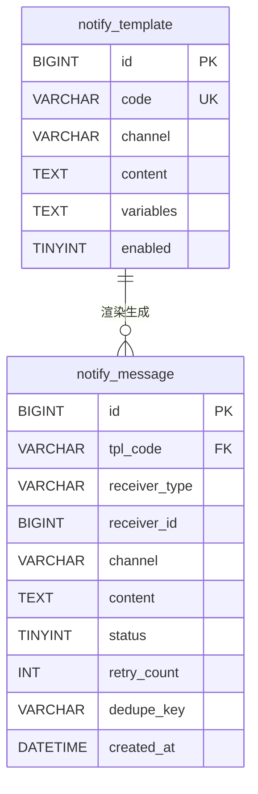

# 工单01 消息通知与告警中心 — ER 图

> **工单编号：01｜消息通知**　需求来源：智能快寄柜 10 份任务工单 V1.x　创建人：邹世军　出品：八维文化与产业研究院（内容由 AI 生成，仅供参考）

## 1. 实体关系（Mermaid）

## 2. 关系说明
| 关系 | 基数 | 说明 |
|---|---|---|
| notify_template → notify_message | 1 : N | 一个模板可生成多条通知消息，通过 `tpl_code` 关联（逻辑外键，非物理 FK） |

## 3. 关联口径
- `notify_message.tpl_code` 逻辑关联 `notify_template.code`，读取模板变量清单与正文。
- 接收方 `receiver_type + receiver_id` 为多态关联，分别指向 admin / site_admin / user，不做物理外键。
- 出于写入性能与分库考虑，本模块未建立物理外键约束，一致性由应用层保证。
