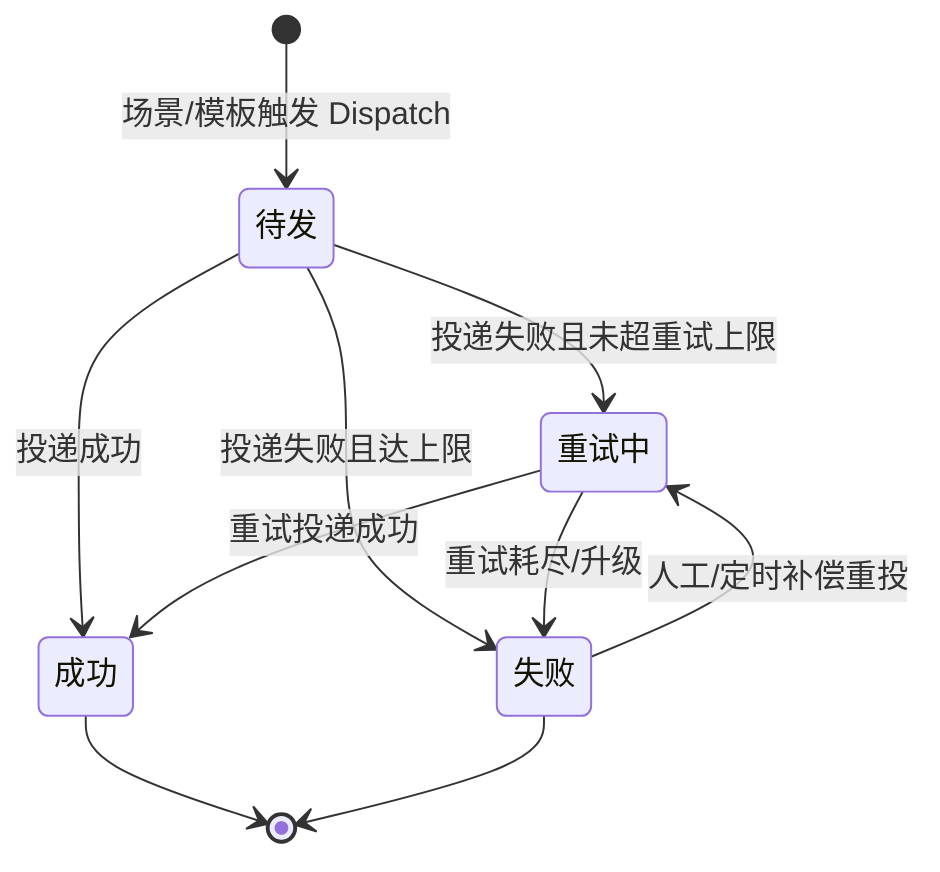

# 工单01 消息通知与告警中心 — 状态转换图

> **工单编号：01｜消息通知**　需求来源：智能快寄柜 10 份任务工单 V1.x　创建人：邹世军　出品：八维文化与产业研究院（内容由 AI 生成，仅供参考）

## 1. 通知消息状态机（Mermaid）

## 2. 状态定义
| 状态值 | 名称 | 含义 | 触发动作 |
|---|---|---|---|
| 0 | 待发 | 已生成待投递 | Dispatch 落库 |
| 1 | 成功 | 渠道回执成功 | 渠道 ack / 回调成功 |
| 2 | 失败 | 投递失败且不可再投 | 重试耗尽或不可重试错误 |
| 3 | 重试中 | 失败后进入退避重试 | retry_count++ 并重新投递 |

## 3. 转换规则
1. 去重命中：若 `dedupe_key` 在频控窗口内已存在，直接返回重复请求（ErrDup=10007），不新建消息。
2. 失败重试：采用指数退避，重试次数写入 `retry_count`，超过上限后置为失败并按升级策略通知管理员。
3. 升级：失败达到阈值后，按 `失败重试与升级策略说明.md` 升级到高优先级渠道。
