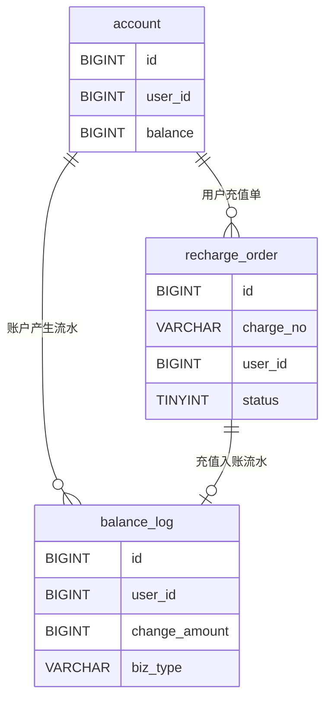

# 工单02 快寄员支付宝支付 — ER 图

> **工单编号：02｜快寄员支付宝支付**　需求来源：智能快寄柜 10 份任务工单 V1.x　创建人：邹世军　出品：八维文化与产业研究院（内容由 AI 生成，仅供参考）

## 1. 实体关系（Mermaid）

## 2. 关系说明
account 与 balance_log 通过 user_id 关联；recharge_order 通过 charge_no 与回调交易号 trade_no 对应，回调成功后产生一条余额流水。

| 实体A | 基数 | 实体B | 说明 |
|---|---|---|---|
| account | ||--o{ | balance_log | 账户产生流水 |
| recharge_order | ||--o| | balance_log | 充值入账流水 |
| account | ||--o{ | recharge_order | 用户充值单 |

## 3. 关联口径
- 关联字段通过业务主键（order_no / user_id / site_id 等）建立，一致性由应用层维护。
- 多态接收方、缓存计数等非结构化数据不纳入 ER 物理模型。
