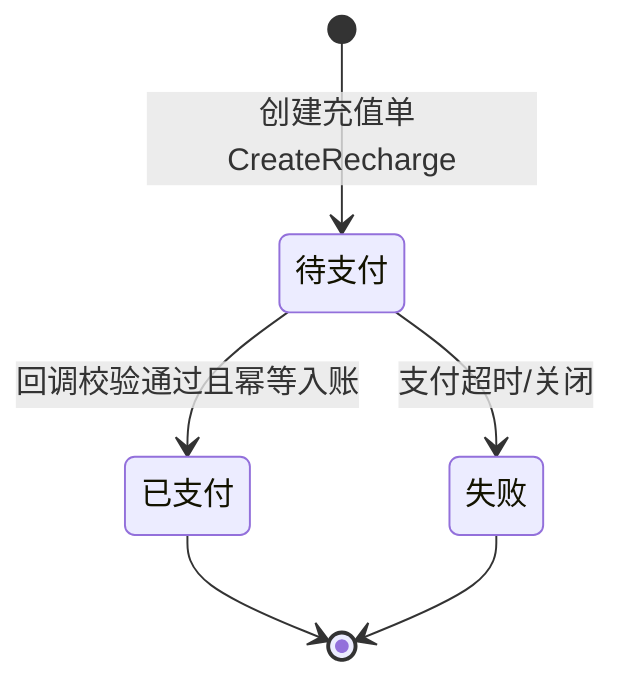

# 工单02 快寄员支付宝支付 — 状态转换图

> **工单编号：02｜快寄员支付宝支付**　需求来源：智能快寄柜 10 份任务工单 V1.x　创建人：邹世军　出品：八维文化与产业研究院（内容由 AI 生成，仅供参考）

## 1. 状态机（Mermaid）

## 2. 状态定义
| 状态值 | 名称 | 含义 | 触发动作 |
|---|---|---|---|
| 1 | 待支付 | 已创建充值单，等待支付宝回调 | CreateRecharge |
| 2 | 已支付 | 回调校验通过并入账 | RechargeCallback |
| 3 | 失败 | 支付超时或关闭 | 超时任务 |

## 3. 转换规则
1. 回调使用 charge_no + trade_no + amount + signature 校验，校验失败返回 ErrPayCallback(12003)。
2. 幂等：uk_biz(biz_type,biz_no) 与 idempotency_key 保证同一充值只入账一次，重复回调返回 ErrDup(10007)。
3. 入账与订单状态更新在同一事务内完成，余额以 DB 为准。
