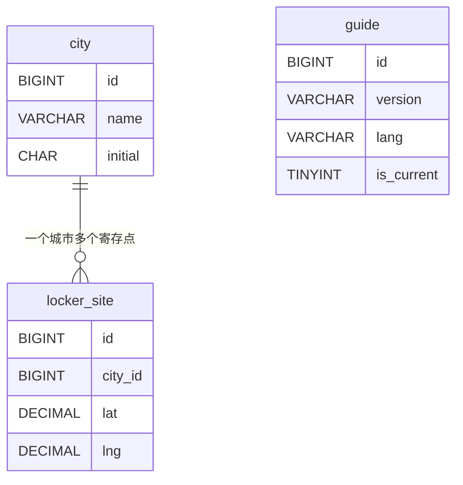

# 工单03 首页 — ER 图

> **工单编号：03｜首页**　需求来源：智能快寄柜 10 份任务工单 V1.x　创建人：邹世军　出品：八维文化与产业研究院（内容由 AI 生成，仅供参考）

## 1. 实体关系（Mermaid）

## 2. 关系说明
city 与 locker_site 通过 city_id 一对多关联；guide 为独立内容表，按 version 唯一，与城市/寄存点无物理外键。

| 实体A | 基数 | 实体B | 说明 |
|---|---|---|---|
| city | ||--o{ | locker_site | 一个城市多个寄存点 |

## 3. 关联口径
- 关联字段通过业务主键（order_no / user_id / site_id 等）建立，一致性由应用层维护。
- 多态接收方、缓存计数等非结构化数据不纳入 ER 物理模型。
