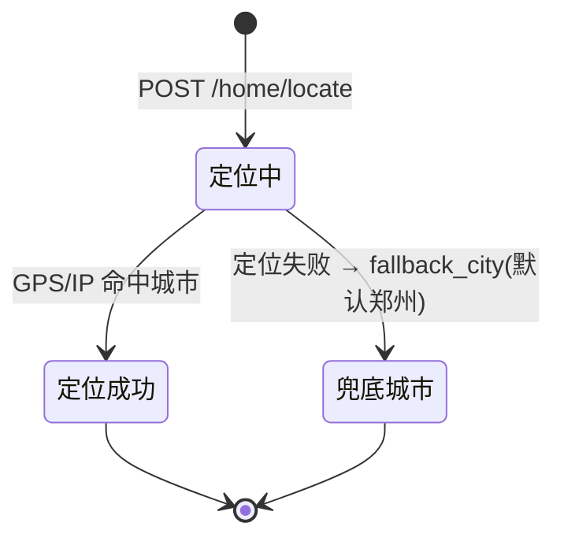

# 工单03 首页 — 状态转换图

> **工单编号：03｜首页**　需求来源：智能快寄柜 10 份任务工单 V1.x　创建人：邹世军　出品：八维文化与产业研究院（内容由 AI 生成，仅供参考）

## 1. 状态机（Mermaid）

## 2. 状态定义
| 状态值 | 名称 | 含义 | 触发动作 |
|---|---|---|---|
| — | 定位中 | 正在根据 lat/lng/IP 解析城市 | Locate |
| OK | 定位成功 | 解析到有效城市 | 返回 city |
| FALLBACK | 兜底城市 | 定位失败用默认城市 | fallback_city |

## 3. 转换规则
1. 定位失败返回 ErrLocFail(11001)，但接口降级到 fallback_city（默认郑州）保证首页可用。
2. 城市不存在返回 ErrCityNF(11002)。
3. 城市/寄存点读取为读接口，不强制鉴权。
