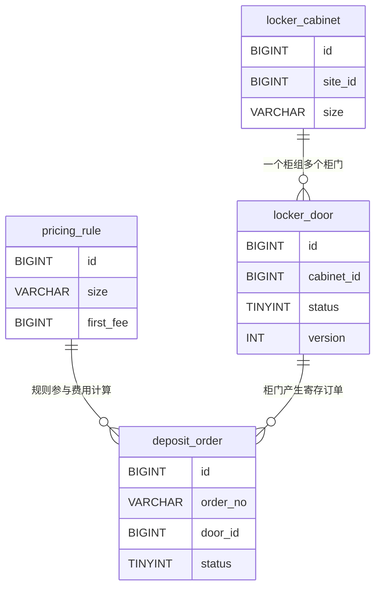

# 工单04 物品寄存 — ER 图

> **工单编号：04｜物品寄存**　需求来源：智能快寄柜 10 份任务工单 V1.x　创建人：邹世军　出品：八维文化与产业研究院（内容由 AI 生成，仅供参考）

## 1. 实体关系（Mermaid）

## 2. 关系说明
locker_cabinet 与 locker_door 一对多；deposit_order 通过 door_id 关联柜门、通过 size 命中的 pricing_rule 计算费用（逻辑关联）。

| 实体A | 基数 | 实体B | 说明 |
|---|---|---|---|
| locker_cabinet | ||--o{ | locker_door | 一个柜组多个柜门 |
| pricing_rule | ||--o{ | deposit_order | 规则参与费用计算 |
| locker_door | ||--o{ | deposit_order | 柜门产生寄存订单 |

## 3. 关联口径
- 关联字段通过业务主键（order_no / user_id / site_id 等）建立，一致性由应用层维护。
- 多态接收方、缓存计数等非结构化数据不纳入 ER 物理模型。
