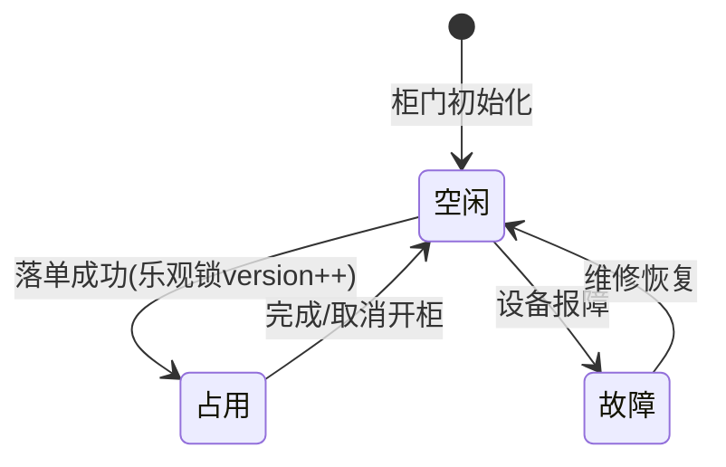

# 工单04 物品寄存 — 状态转换图

> **工单编号：04｜物品寄存**　需求来源：智能快寄柜 10 份任务工单 V1.x　创建人：邹世军　出品：八维文化与产业研究院（内容由 AI 生成，仅供参考）

## 1. 状态机（Mermaid）

## 2. 状态定义
| 状态值 | 名称 | 含义 | 触发动作 |
|---|---|---|---|
| 0 | 空闲 | 柜门可用 | 初始化/释放 |
| 1 | 占用 | 已落单寄存中 | 落单成功 |
| 2 | 故障 | 设备不可用 | 报障 |

## 3. 转换规则
1. 落单采用乐观锁（version CAS）抢占柜门，冲突返回 ErrLock(10008) 请重试。
2. 费用试算按 size 取最高优先级启用规则，未匹配返回 ErrBillingRule(13002)。
3. 柜门不可用返回 ErrLockerBusy(13001)；订单不存在返回 ErrDepositNF(13003)。
