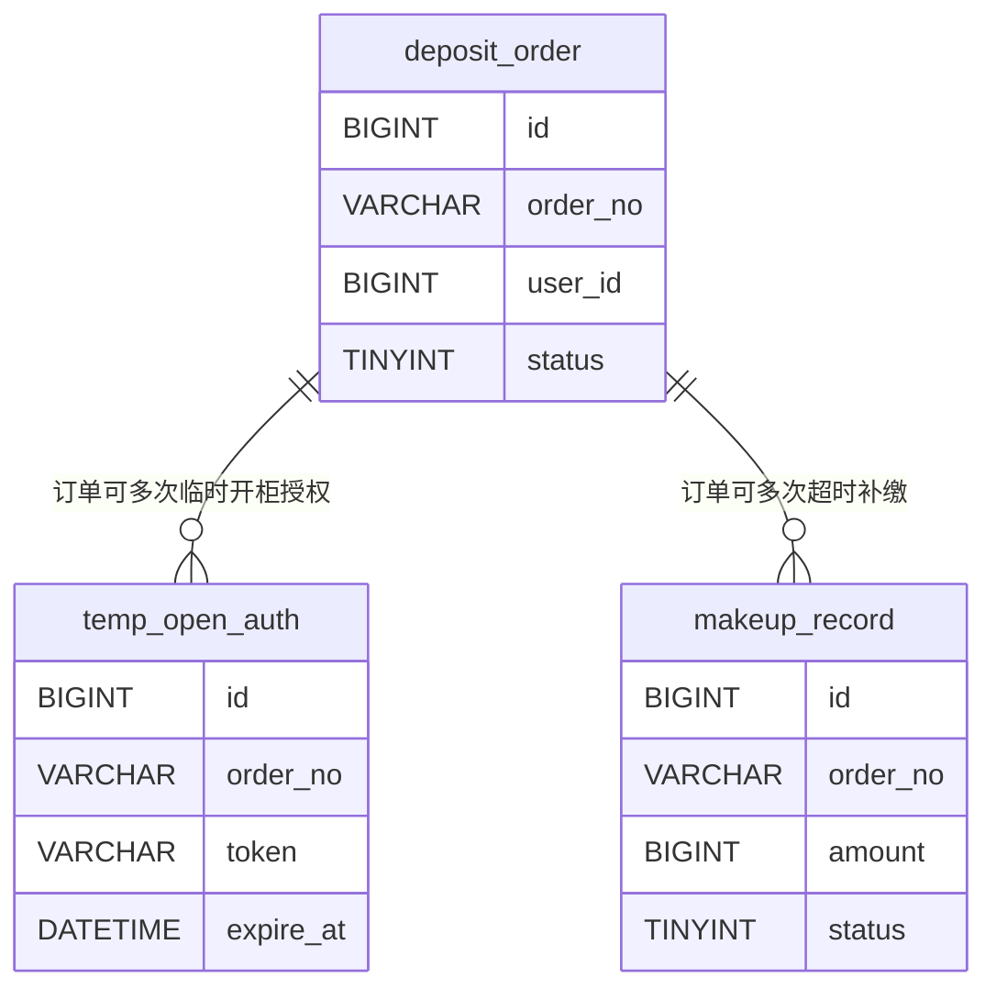

# 工单05 订单查看与取出 — ER 图

> **工单编号：05｜订单查看与取出**　需求来源：智能快寄柜 10 份任务工单 V1.x　创建人：邹世军　出品：八维文化与产业研究院（内容由 AI 生成，仅供参考）

## 1. 实体关系（Mermaid）

## 2. 关系说明
deposit_order 与 temp_open_auth、makeup_record 通过 order_no 一对多关联；三表均以 order_no 作为业务纽带。

| 实体A | 基数 | 实体B | 说明 |
|---|---|---|---|
| deposit_order | ||--o{ | temp_open_auth | 订单可多次临时开柜授权 |
| deposit_order | ||--o{ | makeup_record | 订单可多次超时补缴 |

## 3. 关联口径
- 关联字段通过业务主键（order_no / user_id / site_id 等）建立，一致性由应用层维护。
- 多态接收方、缓存计数等非结构化数据不纳入 ER 物理模型。
