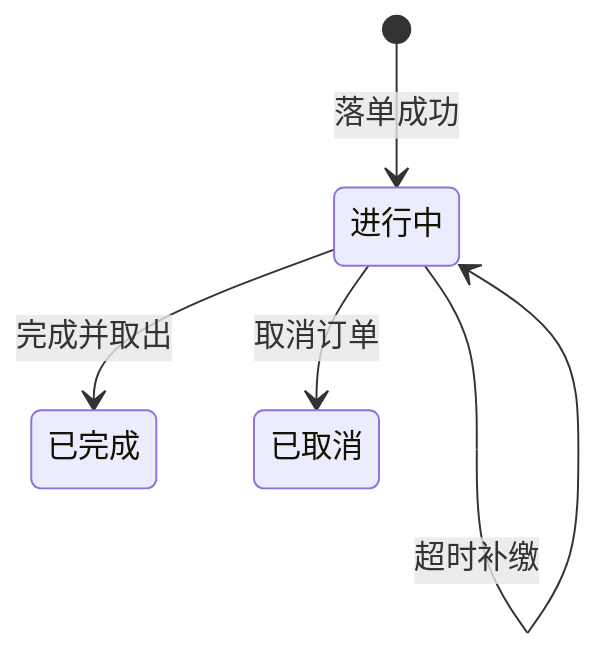

# 工单05 订单查看与取出 — 状态转换图

> **工单编号：05｜订单查看与取出**　需求来源：智能快寄柜 10 份任务工单 V1.x　创建人：邹世军　出品：八维文化与产业研究院（内容由 AI 生成，仅供参考）

## 1. 状态机（Mermaid）

## 2. 状态定义
| 状态值 | 名称 | 含义 | 触发动作 |
|---|---|---|---|
| 1 | 进行中 | 寄存中，可开柜/补缴/完成 | 落单 |
| 2 | 已完成 | 已取出并结算 | CompleteOrder |
| 3 | 已取消 | 已取消并释放柜门 | 取消 |

## 3. 转换规则
1. 仅"进行中"允许临时开柜、超时补缴、完成；非进行中返回 ErrOrderState(14004)。
2. 临时开柜：token 未过期且 used_times<max_times 才允许，否则 ErrOpenAuth(14001)/ErrTokenExp(14002)。
3. 超时补缴与完成按幂等键去重，避免重复扣款。
