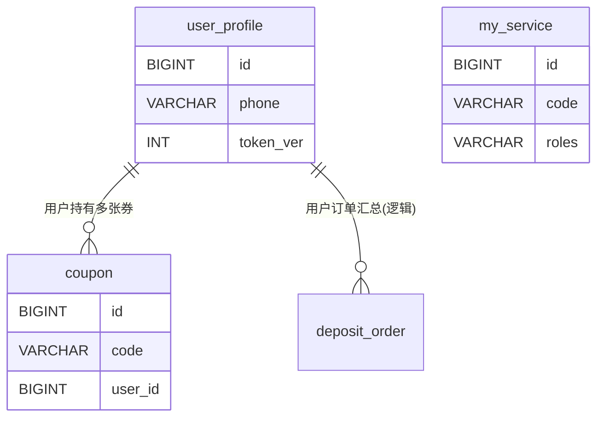

# 工单06 个人中心 — ER 图

> **工单编号：06｜个人中心**　需求来源：智能快寄柜 10 份任务工单 V1.x　创建人：邹世军　出品：八维文化与产业研究院（内容由 AI 生成，仅供参考）

## 1. 实体关系（Mermaid）

## 2. 关系说明
user_profile 与 coupon 通过 user_id 一对多；订单汇总通过 user_id 关联 deposit_order（逻辑关联，见工单05）；my_service 为独立配置表。

| 实体A | 基数 | 实体B | 说明 |
|---|---|---|---|
| user_profile | ||--o{ | coupon | 用户持有多张券 |
| user_profile | ||--o{ | deposit_order | 用户订单汇总(逻辑) |

## 3. 关联口径
- 关联字段通过业务主键（order_no / user_id / site_id 等）建立，一致性由应用层维护。
- 多态接收方、缓存计数等非结构化数据不纳入 ER 物理模型。
