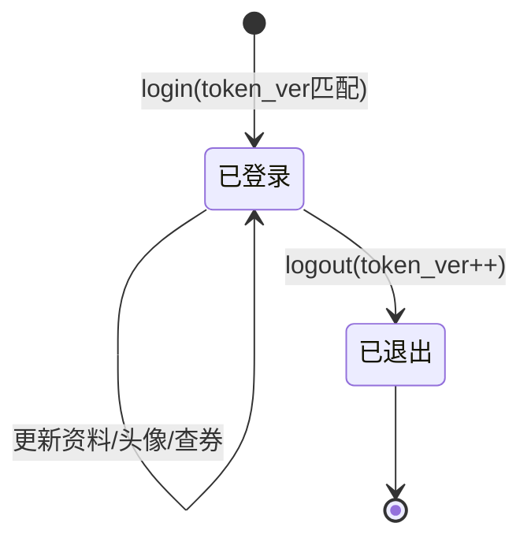

# 工单06 个人中心 — 状态转换图

> **工单编号：06｜个人中心**　需求来源：智能快寄柜 10 份任务工单 V1.x　创建人：邹世军　出品：八维文化与产业研究院（内容由 AI 生成，仅供参考）

## 1. 状态机（Mermaid）

## 2. 状态定义
| 状态值 | 名称 | 含义 | 触发动作 |
|---|---|---|---|
| LOGGED | 已登录 | 令牌有效，可访问个人中心 | Login |
| LOGOUT | 已退出 | 退出后旧token失效 | Logout |

## 3. 转换规则
1. 退出登录：user_profile.token_ver 自增，历史 token 因版本不匹配失效，返回 10002 未授权。
2. 优惠券可用：未过期且 used=0；否则返回 ErrCoupon(15001)。
3. 头像上传限制类型/大小，路径入库，防止路径穿越。
